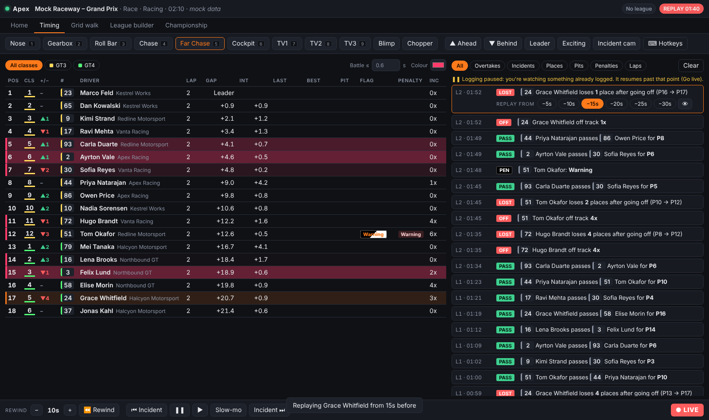
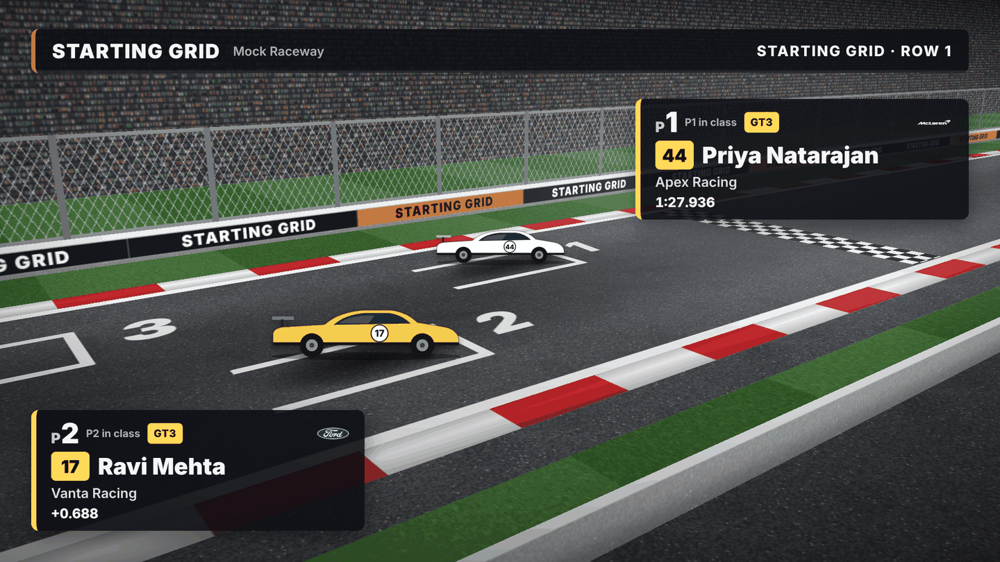
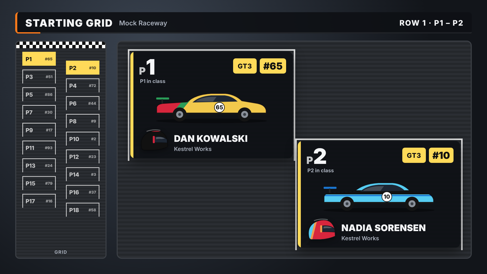
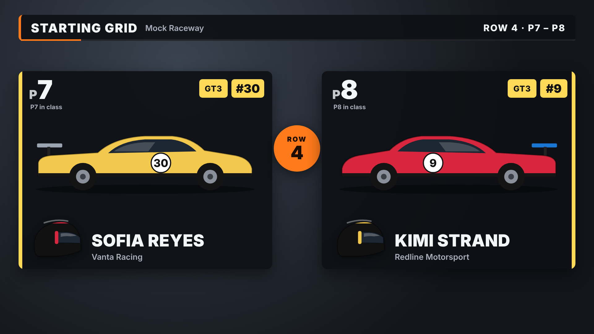
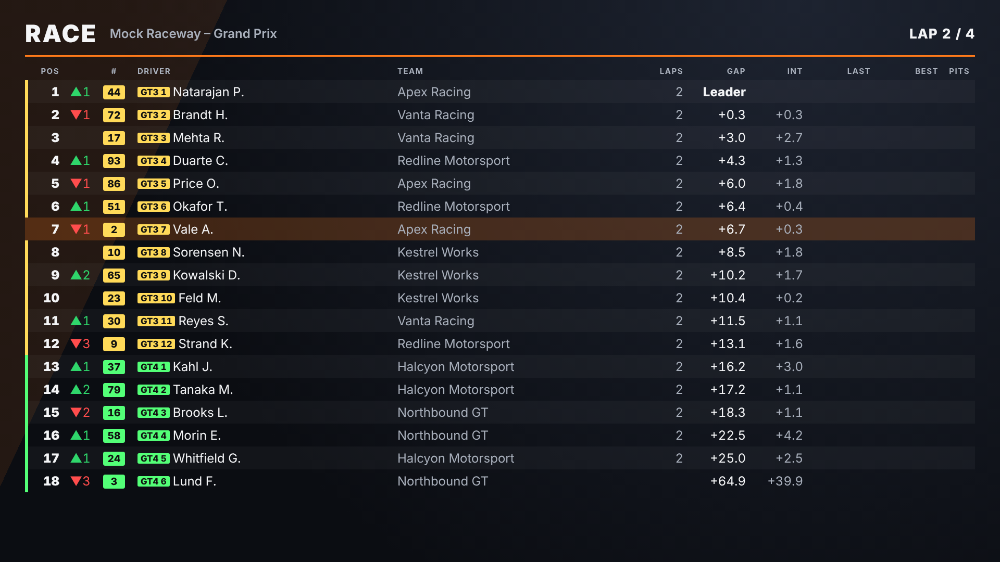
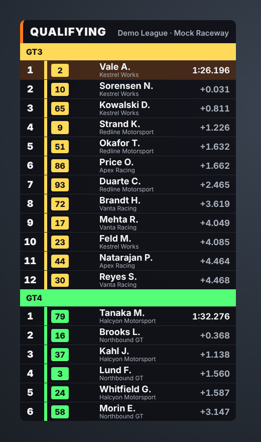
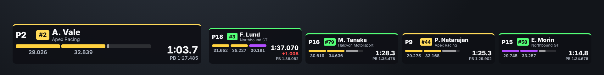
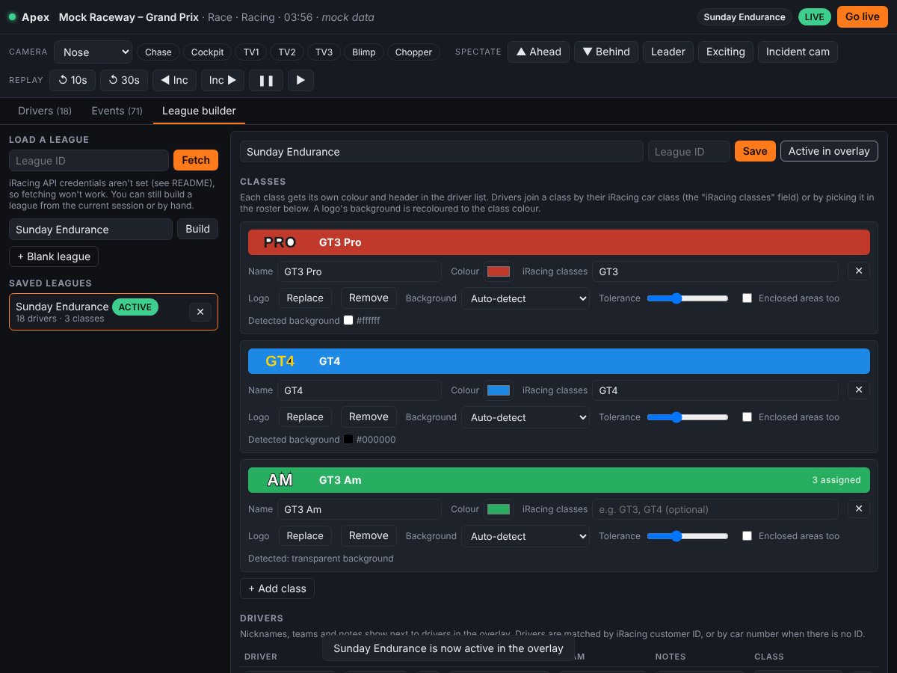

# Apex Commentator

A lightweight iRacing overlay suite for commentators. It runs a small local web
app next to iRacing. Open it in a browser on a second monitor, or add it as an
OBS dock.

- **Timing screen**: one screen for the race. Live standings with overall
  and class position, places gained or lost, gap and interval, flags and
  penalties. **Battles** (cars within 0.15 s) flash in a colour you choose.
  Click a driver to put the camera on them. A **race log** records
  overtakes, offs, spins, places lost, pit stops, penalties and fastest laps:
  pick a line and replay it from 5 to 30 seconds before. Camera buttons with
  your own hotkeys sit along the top, and replay controls and **LIVE** along
  the bottom.
- **League builder**: pull a league roster from iRacing by **League ID**, from
  the current session, or add drivers by hand. Add nicknames, teams, team
  logos, notes and car and helmet photos. Define **classes** with your own
  names, colours and logos.
- **Grid walk**: an on-stream graphic that walks the starting grid two drivers
  at a time, with livery, helmet, name, team and team logo. It's shown as cars
  standing on the grid, on a grid map or as a head-to-head, and advances on a
  timer you set. The **photo booth** photographs every car in iRacing for it.
- **Standings overlay**: a timing tower for stream, overall or by class. In
  qualifying it starts empty and fills as drivers set clean laps.
- **Qualifying lap tracker**: live sector bars (purple, green, yellow) and lap
  clocks along the bottom of the stream. A big tracker shows the car on camera,
  with the lap time and gap to the driver's best when the lap is done.
- **Team builder**: teams with logos, short names and colours, and who drives
  for whom. They show on every overlay.
- **Championship**: each league's season with your points system, bonuses,
  drop rounds, class and team championships and post-race penalties. Results
  can be imported from the session, and live standings show the championship
  as if the race finished now.



## What's new

<!-- whats-new:start -->
**Coming in the next update**

### New features

- **Show on my screen**: put any overlay or board straight on your monitor,
  over iRacing, instead of using OBS or a browser. Pick the monitor; your
  mouse and keyboard go straight through to the game.

Every version's notes: [CHANGELOG.md](CHANGELOG.md).
<!-- whats-new:end -->

## Install (Windows)

1. Download **`ApexCommentator-Setup-<version>.exe`** from the
   [latest release](https://github.com/ShamzOut2/Apex_Commentator/releases/latest).
2. Run it. It installs for your Windows user, with no admin rights needed. The
   installer isn't code-signed yet, so Windows SmartScreen may warn you:
   choose *More info → Run anyway*.
3. Start **Apex Commentator** from the Start menu or the desktop icon. Join or
   spectate a session in iRacing and it connects automatically. It
   reconnects if iRacing restarts.

No iRacing handy? Use the **Apex Commentator (demo mode)** shortcut for a
simulated race.

The control panel opens in its own window. This uses the Microsoft Edge
WebView2 runtime that comes with Windows 10 and 11. Without it, the app opens
in your browser instead. Your settings and leagues are stored in
`%APPDATA%\Apex Commentator` (`config.json` and `data\`), and a log is kept in
`apex.log` there. A portable zip is attached to each release too, if you
don't want to install.

## Run from source

Requires **Python 3.9+**.

```bat
git clone https://github.com/ShamzOut2/Apex_Commentator
cd Apex_Commentator
start.bat
```

`start.bat` installs the dependencies (`pyirsdk`, plus `pywebview` for the
app window) and starts the app. From source, `config.json` and `data/` live
in the project folder.

`start-mock.bat` (or `python -m apex --mock`) runs a simulated race. It
works on any OS, and `--mock-speed 5` speeds it up. Other options:
`python -m apex --help` (`--port`, `--host`, `--no-window` to use the browser,
`--config`). `--mock-session qualify` simulates qualifying instead, for trying
the lap tracker. `--mock-laps 10` ends the simulated race after 10 laps, for
trying championship imports.

### Using it from another PC or in OBS

- **Second PC on your LAN:** set `"host": "0.0.0.0"` in `config.json`, then
  open `http://<iRacing-PC-IP>:8180` from the other machine. The overlay
  has no login, so only do this on a network you trust.
- **OBS:** *Docks → Custom Browser Docks*, URL `http://localhost:8180`. The
  layout compacts itself for narrow docks.

## Timing screen

**⧉ Pop out** (next to *Hotkeys*) opens the timing screen in a window of its
own, without the tabs, so it can sit on another monitor while the main window
shows something else. Camera hotkeys work in whichever window has focus.

- **Standings**: Pos (overall), Cls (position in class, underlined in the class
  colour), **+/−** (places gained or lost since the start, within the class
  when a class is picked), car number, driver and team, lap, gap to the
  leader (timed by the app: how long ago the leader was where the car is
  now, so it updates continuously, keeps step with the order and keeps
  counting while a car is slow or stopped; "+1 L" for lapped cars), interval
  to the car ahead, last and best lap, pit stops, flag
  (yellow, blue, white, chequered), penalties (black flag, DQ, meatball,
  warning) and incident points. **Click any driver** to put the camera on
  them. The class chips show one class at a time, with gaps and places within
  it.
- **Battles**: a driver within the battle gap of the car ahead (0.15 s by
  default) flashes along with that car, in the colour you pick. Both settings
  sit above the standings.
- **Race log**: everything that happens, newest first, filterable: overtakes,
  off tracks, spins, incident points, places lost after an off, pit in/out
  (with stop time and places lost), penalties and class fastest laps. **Click
  a line**, then pick how far back to start the replay: −5 s, −10 s and so
  on up to −30 s. The camera follows that driver. The line above the log shows
  whether logging is running: it logs live races and saved replays you play,
  and pauses while you rewind over something already logged.
- **Cameras**: one button per iRacing camera, plus Ahead, Behind, Leader,
  Exciting and Incident cam. *⌨ Hotkeys* sets a key for each camera; out of
  the box, 1–9 are the first nine cameras.
- **Replay bar**: rewind the car on camera by a set time (5 s steps), step
  through iRacing's incident markers, pause, play, slow motion, and **LIVE**.

### Keyboard shortcuts

| Key | Action |
| --- | --- |
| `1`–`9` (or your own) | Camera hotkeys |
| `L` | Back to live |
| `R` | Rewind the car on camera (by the rewind setting) |
| `↑` / `↓` | Watch the car ahead / behind |

## How replays work

The overlay watches telemetry for **every** car, so this works when you
spectate. It records:

| Event | How it is detected |
| --- | --- |
| **Overtake** | In a race under green, cars close on track swap order *and stay swapped* for 1.5 s, with both on track. Swaps from pit stops, offs or side-by-side jostling don't count. The event is timestamped when the pass started. |
| **Off track** | A car's track surface changes to off track. |
| **Slowdown** (SLOW) | A car's speed collapses relative to its recent pace *and* it's well under the usual speed at that point of the track, so braking hard for a hairpin doesn't count. The app learns each corner's usual speed from the cars going through it. Ignored on pit road and under caution. |
| **Spin** (SPIN) | A slowdown or off track where the car also rotates sharply within 0.2 s. iRacing only sends a car's heading for the car driven on this PC, so for that car it's the heading turning 45°+ in 0.2 s. For every car, it's the steering snapping 180°+ of opposite lock in 0.2 s, or the car travelling backwards along the track (it has turned round). Without any of these, the moment stays a slowdown or off track. |
| **Contact** (CONTACT) | Two cars touching. iRacing doesn't report contact between other cars, so the app looks for two signs. First, a car closing fast on the one just ahead (within a few metres) that suddenly stops closing within 0.12 s: the jolt of a hit, quicker than any braking. Second, a driver getting 4x (iRacing's car-contact incident) while another car was right next to them. That car is named, and the other driver's 4x goes on the same entry. |
| **Incident points** | When iRacing reports more incident points for a driver, they are attached to that driver's off/slowdown from the last 15 s, or logged as their own incident. |

Pressing **Replay** pauses playback, seeks the replay tape to the event's
session time minus a pre-roll (6 s by default), points the camera at the
driver and plays. It seeks by **session time**, not frame numbers or
iRacing's incident markers, so it lands on the right moment even after you
have been scrubbing around. **Go live** (or `L`) returns to the live feed.
Set `replay_auto_return_s` to return automatically.

Other replay buttons: **↺ 10s / 30s** (instant replay of whoever is on camera),
**◀ Inc / Inc ▶** (step through iRacing's own incident markers), pause/play.

Things to know:

- Replays need iRacing's replay buffer. Keep *Options → Replay → Write
  Replay Data* enabled, and give it enough memory to cover the race.
- Detection pauses while you are watching a replay (telemetry then shows the
  replay, not the live race), so moments that happen during a replay are
  not logged. iRacing's **◀ Inc / Inc ▶** markers still cover them.
- Incident **points** for other drivers only appear if iRacing shares them
  with you, for example as a league admin or in hosted sessions. Off-track and
  slowdown detection works regardless.
- Thresholds (`overtake_hold_s`, `slowdown_ratio`…) can be tuned in
  `config.json`.

## Grid walk



The **Grid walk** tab runs a broadcast graphic that goes through the whole
field, front to back, two drivers at a time:

- **Order**: the grid comes from qualifying. If there are no qualifying
  results yet, the latest qualifying session's results are used, then current
  positions, then car number. Every driver entered in the session is included,
  even if they haven't loaded onto the track (flagged *Not on track*). Drivers
  without a qualifying time go to the back. Use **↑ / ↓** to fix the order by
  hand (inverted grids, penalties), and **Reset order** to go back.
  *League drivers not in session* adds the active league's remaining roster at
  the back.
- **Each driver** shows grid position (and class position in multiclass
  races), car number in the class colour, class logo, name, nickname, team,
  team logo, car livery and helmet. *Grid on track* also paints each slot's
  qualifying time on the tarmac: the lap time for the class pole, and the gap
  to it for everyone else.
- **Photos**: upload a car livery photo and a helmet photo per driver in the
  league builder (**Photos** column), and team logos in the **Teams**
  section. For *Grid on track*, the ideal car image is a **transparent PNG
  render** of the car in 3/4 view, nose pointing right, so it stands in the
  grid box like a TV grid walk. A driver without photos gets a car and helmet
  drawn in their actual iRacing paint colours (from the sim's design
  strings), so nobody shows up blank.
- **Controls**: *Start from P1*, *Pause/Resume*, *Prev/Next* pair, *Show*
  on any driver to jump to their pair, and *Hide* to take it off screen.
  *Seconds per pair* sets the timer, and *Loop* restarts from the front.
  Without Loop, the graphic leaves the screen after the last pair.
- **Style**:
  - *Grid on track* (default): the pair stands in painted, staggered grid
    boxes on an angled stretch of track, with slot numbers and qualifying
    gaps on the tarmac. Name, number and team go in opposite corners with
    the team logos. It's a full-frame scene with its own background.
  - *Grid map* draws the whole grid with the current pair lit up, and the
    two driver cards in their boxes.
  - *Head to head* puts the pair side by side.

| Grid map | Head to head |
| --- | --- |
|  |  |

**On stream**: in OBS add a **Browser Source** of 1920×1080 pointing at
`http://localhost:8180/gridwalk.html`. The *Grid map* and *Head to head*
styles have a transparent background, so they sit over your game feed. The walk runs on the server, so the OBS source, the
preview in the tab, and any other copy all stay in step. Add `?preview=1` to
the URL to view it on a backdrop in a normal browser.

### Photo booth: real car photos from iRacing

The **Photo booth** in the Grid walk tab takes each driver's car photo
inside iRacing itself, so it shows their real livery, whether that's a
Trading Paints paint or an iRacing paint-shop design. For every car loaded
into the session, it points the chosen camera at the car, hides iRacing's
on-screen panels, takes iRacing's screenshot, then puts your camera and panels
back. Each shot is then **cut out** with an AI background-removal model (the
open IS-Net model, about 170 MB, downloaded the first time you use it), cropped
to the car, and saved as that driver's car photo in the active league. The
grid walk uses it straight away. 📷 on a driver's row retakes just that car.

- **Turn on screenshots in iRacing first**: *Settings → Interface → Camera &
  Screen Capture → Video and Screen Capture*, then restart iRacing. The app
  looks in `Documents\iRacing\screenshots`. If yours are saved elsewhere,
  set the **Screenshots folder** under the photo booth.
- **Moved your iRacing documents folder?** If `Documents\iRacing` is a
  junction (a folder link) to another drive, newer Windows 11 builds refuse
  to open it through the link ("WinError 448: untrusted mount point"). The
  app follows the link to the real folder itself. If it still can't, set
  the **Screenshots folder** to the real one (e.g. `D:\iRacing\screenshots`).
- **When**: it takes over the camera for about 2 seconds per car, so run it
  before you go live. The cut-outs are made afterwards, in the background.
- **Cars spread out make better photos**: the cut-out keeps the car in the
  middle of the shot and drops cars that merely touch it. A car that
  overlaps another in the frame can't be separated, so practice and
  qualifying, when cars are apart, are a better time than the grid. Try
  cameras such as *Chase*, *Rear Chase* or a TV camera, and retake any that
  come out wrong.
- Cars not loaded into the session can't be photographed. They keep their
  uploaded or drawn car. Untick *Cut out background* to keep the track behind
  the car. Raw shots are kept in `data\photobooth\raw`.

## Stream overlays

Each overlay also has a **full-screen** version (`/standings.html?screen=1`,
`/laps.html?screen=1`): a complete screen with its own background, to cut to
on stream or put on a monitor (open it, then F11).
- **Standings board**: every driver. In a race it shows laps, gap,
  interval, last and best lap and pit stops. In qualifying it shows best lap,
  gap and interval. Big fields split into columns.
- **Live timing**: every driver in qualifying, with sector boxes coloured as
  they're set, the running lap clock, best lap and gap.



The **Overlays** tab has each overlay's address for OBS, a live preview and
its settings. Add each one as a *Browser Source* at 1920×1080 (the background
is transparent). Settings changed in the tab show on stream straight away and
are kept in `data/overlays.json`.

- **Standings** (`/standings.html`): in a race, the running order with the gap
  to the leader. In qualifying and practice, it shows the fastest clean lap,
  and drivers only appear once they have one, so it starts empty.
  - *Overall* lists everyone. Each driver's class shows in the colour of
    their number and stripe.
  - *By class* gives each class its own block with its header and logo, or
    shows just one class.
  - **Header**: the session, with laps or time left. *Automatic* follows how
    the session is limited ("LAP 5 / 20", then "FINAL LAP" and
    "FINISHED"; or "12:34 LEFT"). You can also pick laps, time or nothing.
  - **Fill in as drivers complete a lap**: at the start of any session, only
    the header shows. Each driver appears as they cross the line to start
    their next lap, so in a race the tower builds up in order at the end of
    lap 1. In qualifying, a driver with a lap done but no clean time yet is
    listed at the bottom.
  - **Columns** (each on or off):
    - gap to the leader (or to pole);
    - interval to the car ahead;
    - places gained or lost since the start;
    - best lap and last lap;
    - laps completed and pit stops;
    - a PIT badge on pit road.

    Small labels head the columns, and the tower widens to fit them.
  - Choose the name style, how many drivers, and whether to show car numbers,
    team names and team logos.
  - **Last N drivers** (Overall view): when there are more drivers than rows,
    the last few (last place included) are added at the bottom, after a
    small gap. 0 turns it off.
  - **Close racing**: with the *Interval* column on, a driver within 0.15 s
    of the car ahead has their interval in red text. It stays red until they get
    past (then whoever is now right behind turns red, if close enough) or
    the gap opens up. It's racing under green only, not behind the safety
    car. Set the threshold, or 0 to turn it off.
  - **Transitions**: drivers slide up and down the tower as they change
    places, with a brief green (gained) or red (lost) glow. New drivers fade
    in. The stopwatch pops in when the fastest lap changes hands. The
    fastest-lap pill drops in saying "NEW FASTEST LAP", then switches to the
    driver and lap time, and fades out at the end.
  - **Fastest lap**: a purple stopwatch by the holder's name. In Overall it's
    the one fastest driver; in By class, each class's fastest.
  - **New fastest lap flash**: when someone sets a new fastest lap, a purple
    pill appears at the top middle of the screen with a stopwatch. It says
    "NEW FASTEST LAP" for about two seconds, then shows the driver and the lap
    time. Set how many seconds it stays (3 or more). It can also flash each
    class's new fastest lap. Races skip the first lap; laps set before the
    app connected don't flash.
- **Sponsors** (`/sponsors.html`): the active league's sponsor logos (added
  in the League builder) over the race. Choose a corner or the middle of an
  edge, all together or one at a time (and how long each shows), the size,
  a caption such as "Partners", a dark panel behind, and which sponsors.
- **Lap tracker** (`/laps.html`): only in qualifying (practice too, if you
  tick it).
  - The car on camera gets the big tracker. Up to 12 small ones show other
    cars on a timed lap, nearest the line first.
  - Each sector bar fills as the car goes round and turns solid when the
    sector is done:
    - **purple**: faster than the reference;
    - **green**: within 0.2 s of it (adjustable);
    - **yellow**: slower.
  - The track's timing split points are merged into 3 sectors by default,
    like TV. The *Sectors* setting offers 2, 3, 4, or every split point the
    track has. The time sits inside each finished sector; with many sectors
    the small trackers show just the colours.
  - The reference is the driver's own best ("personal") or the fastest in
    their class this session ("session").
  - The driver's best lap is always shown. When a lap is done, its time
    stays up with the gap to that best (green if faster, red if slower), then
    the tracker goes after 5 s (adjustable).
  - Laps aren't timed out of the pits. A lap is marked invalid if the car goes
    off track or into the pits, and invalid laps never count as bests.
  - Sector splits come from iRacing's sector points for the track. Lap times
    use iRacing's own time when it reports one.





## Team builder

The **Teams** tab works on the same league as the League builder. For each
team, set:
- its name (renaming moves its drivers with it);
- a short name, used where space is tight;
- a colour (optional; the class colour is used otherwise);
- its logo.

Add drivers to a team from the drop-down, or take them out with ✕. The roster's
*Team* column in the League builder is the same thing. **Save** saves the
league. The roster also has a **Driver #** column, for leagues that give
drivers their own number; the lap tracker can show it.

## Overlays on your own screen (no OBS)

Every overlay and board can also go straight on your monitor instead of into
OBS or a browser. In the app window, press **Show on my screen** under its
link: the Overlays tab for the standings tower, lap tracker (and their full
screen versions) and sponsors, the Boards tab for boards, and the Grid walk tab.

- It sits over whatever is on that monitor, always on top. Run iRacing in
  **windowed or borderless** mode: a game in exclusive full screen covers it.
- It never takes the keyboard, and your mouse goes straight through to the
  game or the app underneath.
- With more than one monitor, pick which one; changing it moves the overlay.
- **Remove** takes it down; *Remove all from my screen* clears everything.
  They also close with the app.
- The first time, the app asks whether you can see your screen through it.
  If you don't answer within 15 seconds it takes the overlay down by itself
  (in case it came up solid and covered your screen). From then on it just
  appears.

This needs the app window (it isn't available when the app runs in a browser).
Soft drop shadows are left out on screen, since only fully see-through parts
can show the game behind.

## Boards (full-screen championship, calendar and results)

The **Boards** tab puts a full-screen board on stream with one click. Add
`/board.html` to OBS as a *Browser Source* at 1920×1080. It's empty
(transparent) until you put a board on screen, and **Take off screen** clears
it. **⧉ Pop out** opens the Boards tab in a window of its own. The buttons are
built from the active league:

- **Championship standings**: Overall, and one button per class (e.g. PRO,
  SEMI-PRO, AM): that championship's drivers with their points, the gap to
  the leader and, if switched on, the gap to the driver ahead.
- **Teams' championship**: each team's logo and colour, the drivers who
  scored for it, points per round, wins, penalties, and the gaps to the
  leader and to the team ahead.
- **Manufacturers**: by the cars' makes, Overall and per class.
- **Season calendar**: every round with track, layout, date, time and
  length, which rounds are done (with their winners) and which is next. Or
  the league's own calendar image instead (see *League builder*).
- **Finishing order**: Overall or per class, from the latest round, a chosen
  round, or the session going on now (live).

Under *What each board shows*, every board can be set up separately:
- the league logo in its header;
- a league banner across the top or bottom or down either side, and which
  banner;
- the league's sponsor logos along any edge, and which sponsors;
- the board's own columns: car numbers, team names and logos, car badges,
  gaps, wins, penalty points, points from the last few rounds, laps, places
  gained, fastest lap (purple), DNF/DSQ, points scored, and how many rows.

Putting another board on screen crossfades from the old one, and a new
board's header and rows sweep in one after another; **Take off screen**
fades it out. Long tables split into two columns rather than shrinking. Names follow the
league's *Remove driver class in name* setting, and car numbers take the
class colour.

## Championship

The **Championship** tab keeps each league's season. It works on the same
league as the League builder and Teams tabs. Press **Save** after changes; the
standings update from what's saved.

- **Points & rules**
  - Points for each finishing position (e.g. `25, 18, 15, 12, 10, 8, 6, 4,
    2, 1`).
  - Optional points for qualifying positions, taken from the starting grid.
  - **Championships**:
    - *Per class*: scored on class positions; each class is its own
      championship.
    - *Overall*: scored on overall positions; one championship for
      everyone.
    - *Both*: every result scores twice and the points are kept apart. Class
      positions score in the class championship, and overall positions in
      the Overall championship. The overall championship can have its own
      points table. Bonuses and penalty points apply in both, and each
      standings table shows what it's scored on.
      Example (class points 10, 6, 4; overall 20, 15, 10, 5): a PRO driver
      who finishes 3rd overall and 2nd in PRO scores 10 towards Overall and
      6 towards PRO.
  - **Drop rounds**: each driver's worst N rounds don't count. Missed rounds
    are dropped first. Drops only start once a driver has more rounds than N.
  - The fastest-lap bonus can be limited to the top N finishers.
  - **Race distance to score** (75% by default): a driver must complete this
    share of their class winner's laps. Anyone short is a DNF and scores no
    points or bonuses. 0 turns it off.
  - Whether DNFs score for where they're classified.
  - **Team championship**: count every driver, or each team's best N per
    round. With *Both*, teams count their drivers' overall points, or class
    points if you choose.
  - **Bonus points**: pole, fastest lap, led a lap, each lap led, most laps
    led, most places gained, clean race (no incidents), finished, started, and
    race win. Use 0 for bonuses you don't award; negative values take points
    off.
- **Rounds & results**
  - Add the season's rounds, with a points multiplier (2 for double points)
    and *Can't drop* for rounds that always count.
  - After a race, press **Import from session** while still in the session.
    This fills in finishing order, class, grid, laps, laps led, fastest lap
    and incidents from iRacing, and adds drivers missing from the roster.
  - Each driver's status comes from the app watching the race:
    - **Finished**: crossed the line after the chequered flag.
    - **DNF**: started but didn't take the flag (retired, or parked in the
      pits), or fell short of the race distance.
    - **DNS**: never joined the track once the race went green.
  - If the app wasn't running for the whole race, it falls back to iRacing's
    results, which can't tell a car parked in the pits from a finisher.
    Check those statuses by hand.
  - Everything can be corrected by hand, including DSQ and extra points
    (+ or −) for a round. The points column shows what each result scored.
- **Penalties**
  - *Points off* are taken from the driver's total (and their team's) and are
    never dropped.
  - *Licence points* are a running tally per driver, shown in the standings.
- **Standings**
  - One table per class with each round's points. Dropped rounds are struck
    through, and hovering a cell shows its bonuses.
  - Ties are broken by most wins, then most seconds, and so on.
  - Below the drivers is the team championship.
- **Live**
  - During a race with the league active, the standings tab shows the
    championship as if the race finished now: race points, points before,
    live total, gap, and places gained or lost.
  - The race counts as the round marked *Live* (by default, the first round
    without results).
  - The same data is in the app's live feed (`championship` in
    `/api/state`), ready for a points-battle overlay.

## League builder

Open the **League builder** tab.

1. **Fetch by League ID**: pulls the league name and roster (names, customer
   IDs, car numbers, nicknames) from the iRacing Data API. Needs API
   credentials (below).
2. **Build from the current session**: no credentials needed. It takes the
   drivers in the session you are in.
3. **Blank league**: type it in by hand.

Edit nicknames, teams and notes (for example "Championship leader" or a
pronunciation hint), **Save**, then **Use in overlay**. Drivers are matched by
iRacing customer ID, or by car number for hand-added entries without one.
Re-fetching a league updates names and numbers, adds new members and keeps your
notes. Profiles are plain JSON in `data/leagues/`.

**Car**: each driver's car make (Porsche, BMW, Mercedes-AMG…), with its
badge, for the manufacturers' championship and the boards. *Auto* uses the
car they drive in iRacing, worked out from its name. Importing drivers from a
session fills it in, and each championship result keeps the car driven that
round.

**League logo, banners and calendar image** (for the boards):
- **League logo**: shown in the board headers.
- **League banners**: wide ones for across the top or bottom, tall ones for
  the sides.
- **Calendar image**: a calendar graphic the league has made itself, which
  the calendar board can show instead of its own. The rounds you enter still
  drive the standings, results and next-round information.

**Season calendar**: in Championship → *Calendar & results*, each round has
a track and a **configuration** picked from lists, plus date, start time and
length (e.g. "60 min").
- Type to search the track list; the configuration list then shows that
  track's layouts.
- With iRacing API credentials set, **Fetch official track list** downloads
  iRacing's complete list of tracks and layouts.
- Without credentials, a built-in list of iRacing's tracks and main layouts
  is used, plus every track the app has seen in a session. A track not in
  the lists can be typed in.

**Remove driver class in name**: some leagues put the class in front of
driver names, like `(P) Dave Price` or `(PA) Mat Gatter`. Tick this box
(next to the league name) and:
- Every driver with a tag like that gets the name without it, minus the
  space, as their **Nickname** (`Dave Price`). Nicknames you've already typed
  are kept. Drivers added later (from the session or a re-fetch) get one when
  the league is saved.
- The overlays (standings, lap tracker, grid walk, full-screen boards) show
  that nickname as the driver's name, so the name styles work properly
  ("D. Price", "Price D.").
- The grid walk (on stream and its list in the app) uses it too.
- The timing screen and roster keep the full `(P) Dave Price`, so you can spot
  a driver changing class.

**Classes from name tags**: a tag like `(P)` also puts the driver in the
matching league class, so their number and stripe take that class's colour.
The match is the class's name or an entry in its *iRacing classes* field
(e.g. `P`), or else the initials of its name: `P` is Pro, `SP` is Semi-Pro,
`PA` is Pro-Am, `AM` is Am, `G` is Gold, `S` is Silver and `B` is Bronze. The tag in the driver's current iRacing name
counts, so a class change shows as soon as the tag changes. A class picked
for a driver in the roster still wins.

### Classes and logos



Each class has a **name**, a **colour**, and optionally a **logo**.
**Build from the current session** creates one class per iRacing car class,
in iRacing's colours. Rename and recolour them as you like, or add your own
(for example Pro and Am within the same car).

A driver's class comes from:

1. the **Class** picked for them in the roster, or otherwise
2. the first class whose **iRacing classes** list contains their car class
   (e.g. `GT3`), or otherwise
3. their iRacing car class as-is.

On the **Timing** screen, each driver's class position is underlined and
their car number edged in the class colour, and the class chips above the
standings show one class at a time. Class logos head the grid walk cards.

**Built-in logos.** The league's tier logos ship with the app as layered
SVGs in `web/logos/`: PRO, SEMI-PRO, PRO-AM, AM, GOLD, SILVER and BRONZE.
Pick one from a class's **Logo** list. A class named after one of them
("Pro", "Semi Pro", "Gold"…) picks it up automatically. The badge is drawn
in exactly the class colour. The lettering stays white unless white would be
hard to read on that colour (under 3:1 contrast), when it turns dark: Gold
and Silver, for example.

**Logo backgrounds.** You can also upload your own PNG, JPG, WebP or SVG (up
to 8 MB) per class. For SVGs with marked layers, the overlay recolours those
layers exactly (see *Adding logos* below). For any other image it replaces
the logo's background with the class colour, so the logo blends into the
header, and the result updates live as you change the colour:

- **Auto-detect** reads the background from the logo's border: transparent,
  or its most common colour (white, black…). The detected colour is shown
  under the class.
- **Pick logo background** names the colour to replace, for logos where
  auto-detect guesses wrong.
- **Keep logo as is** turns recolouring off.
- **Tolerance** sets how close to the background a pixel must be to get
  recoloured. Raise it for JPEG noise; lower it if parts of the logo get
  eaten.
- **Enclosed areas too** also recolours background-coloured areas that don't
  touch the edge, like the inside of an "O". It's off by default because it
  would also recolour white artwork inside the logo.

By default only the background connected to the logo's edge is replaced,
with anti-aliased edges blended into the new colour. Your original file is kept
untouched, in `data/leagues/logos/<league>/`.

**Adding logos.** `tools/logo_to_svg.py` turns a dark-badge, light-lettering
logo (like the built-in ones) into a layered SVG. Straight badge edges are
fitted as exact lines, and the lettering is traced with Potrace.

```
pip install pillow potracer          # only needed for the converter
python tools/logo_to_svg.py my-logo.png --out-dir web/logos
```

Drop the result in `web/logos/` to add it to the library, or upload it to a
class. In a hand-made SVG, mark the part that should take the class colour
with `data-apex-fill="class"`, and the lettering with `data-apex-fill="ink"`.

### iRacing API credentials

iRacing retired username/password API logins in December 2025. The Data
API now uses OAuth, and a script like this needs a **client ID and client
secret** issued by iRacing ("password limited" grant) plus your iRacing login.
iRacing support handles client ID requests, and has paused new ones at times.
See their [OAuth client credentials article](https://support.iracing.com/support/solutions/articles/31000177790-oauth-client-credentials).

Put them in `config.json` (copy `config.example.json`; `config.json` is
git-ignored) or set environment variables:

```bat
set IRACING_USERNAME=you@example.com
set IRACING_PASSWORD=...
set IRACING_CLIENT_ID=...
set IRACING_CLIENT_SECRET=...
```

Credentials are masked as iRacing requires before they are sent, and only go
to `oauth.iracing.com` and `members-ng.iracing.com`.

## Updates

On start-up, and every few hours after, the app checks this repository's
GitHub releases. The **Updates** panel on the Home page shows:
- your version and the newest one;
- when it last checked, and anything that went wrong;
- **Check now**, **Install update** and **Release page** buttons.

When a newer version is out, the control panel also pops up with its release
notes:

- **Update now** installs the release and restarts the app. The Windows app
  runs the new installer silently, then reopens. A copy run from source
  downloads the new code and copies it over your copy. Open pages, including OBS sources, reload on the
  new version. Your `config.json` and everything in `data/` (leagues, logos,
  photos) are kept.
- **Later** hides the pop-up until the app is next opened. The *Update to
  vX* button in the top bar reopens it.
- **Skip this version** stops the pop-up for that version, but the next one
  will still pop up.

**Private repository**: GitHub only shows a private repository's releases
with an access token. Without one, the Updates panel says so.
1. On GitHub, go to *Settings → Developer settings → Fine-grained tokens →
   Generate*.
2. Give it this repository only, with *Contents: Read-only*.
3. Paste it into *Private repository? Add a GitHub access token* in the
   Updates panel.

The token is kept in `data/settings.json` on that PC and only sent to GitHub.
Making the repository public works too, and needs no token.

If your copy is a **git clone**, the app won't overwrite it. It tells you
to run `git pull` instead. To turn update checks off, set
`"update_check": false`.

### Publishing a new version

1. Bump `__version__` in `apex/__init__.py` (e.g. `0.3.0`).
2. Add a `## v0.3.0` section to `CHANGELOG.md`: it becomes the release notes
   shown in the pop-up.
3. Get it onto `main` (merge the pull request).

The **Release** GitHub Actions workflow sees the new version on `main` and
builds the Windows app on a Windows runner. It smoke-tests the app, builds the
installer, installs it and smoke-tests the installed copy. Then it publishes
the GitHub release with the installer and a portable zip attached. Every
running copy of the app then offers the update. Pushing a `v0.3.0` tag
yourself works too. A version that's already released is skipped.

The same Windows build runs on every pull request and branch push (**Build
Windows app**), and keeps the installer as a downloadable artifact.

### Building the Windows app yourself

```bat
pip install -r requirements.txt -r requirements-desktop.txt pyinstaller
pyinstaller packaging\apex.spec --noconfirm
"%ProgramFiles(x86)%\Inno Setup 6\ISCC.exe" /DAppVersion=0.3.0 packaging\installer.iss
```

This gives `dist\ApexCommentator\ApexCommentator.exe` and
`dist\ApexCommentator-Setup-0.3.0.exe`. `ApexCommentator.exe --smoke-test`
checks a build starts and serves its pages.

## Configuration

All keys are optional. See `config.example.json` for the full list and
defaults:

| Key | Default | Meaning |
| --- | --- | --- |
| `port` / `host` | `8180` / `127.0.0.1` | Where the overlay is served |
| `replay_preroll_s` | `6` | Seconds before the event a replay starts |
| `replay_auto_return_s` | `0` | Return to live after N seconds (0 = manual) |
| `default_camera_group` | `""` | Camera group for Watch/Replay, e.g. `"TV1"` (blank = keep current) |
| `overtake_hold_s` | `1.5` | How long a pass must hold to count |
| `slowdown_ratio` | `0.35` | Speed below this fraction of recent pace counts as a slowdown |
| `slowdown_corner_ratio` | `0.5` | ...and below this fraction of the usual speed at that point of the track |
| `spin_window_s` | `0.2` | The rotation that makes a spin must happen within this many seconds |
| `spin_yaw_deg` | `45` | Heading change in that window that counts (car driven on this PC only) |
| `spin_steer_deg` | `180` | Steering-wheel snap in that window that counts (every car) |
| `contact_jolt_kph` | `20` | Contact: how fast a car must be closing before suddenly stopping closing |
| `poll_hz` | `30` | Telemetry samples per second (spin detection needs 20 or more) |
| `event_cooldown_s` | `8` | Minimum gap between incidents logged for the same car |
| `gridwalk_interval_s` | `8` | Grid walk: seconds each pair stays on screen |
| `gridwalk_style` | `"track"` | Grid walk style: `"track"`, `"grid"` or `"h2h"` |
| `update_check` | `true` | Check GitHub for new versions and offer them in the app |
| `update_repo` | `"ShamzOut2/Apex_Commentator"` | Where releases are published |
| `github_token` | `""` | Only needed if that repository is private (or set `APEX_GITHUB_TOKEN`) |

## Development

```
apex/
  sources.py   iRacing (pyirsdk) and mock telemetry sources
  events.py    overtake / incident detection
  core.py      poll loop, snapshot, spectate & replay commands
  gridwalk.py  grid order and grid walk state
  laps.py      lap and sector timing for the lap tracker and standings
  overlays.py  stream overlay settings
  championship.py  championship points, drop rounds, penalties and live projection
  league.py    iRacing Data API client and league profiles
  server.py    stdlib HTTP server + Server-Sent Events
  updater.py   update checks and in-app updates from GitHub releases
  desktop.py   app window, single instance, message boxes, log file
  paths.py     program files vs. user data, for source and packaged app
web/           the overlay UI (plain HTML/CSS/JS, no build step)
  index.html   control panel (app.js)
  gridwalk.html  grid walk broadcast graphic for OBS (gridwalk.js)
  standings.html, laps.html  standings tower and qualifying lap tracker for OBS
  sponsors.html  sponsor logos for OBS
  common.js    shared helpers: logo recolouring, drawn liveries
  logos/       built-in layered class logos
packaging/     PyInstaller recipe (apex.spec) and Inno Setup installer script
assets/        app icon
tools/
  logo_to_svg.py  converts badge logos to layered SVG (dev only)
tests/
```

Run the tests with `python -m unittest discover -s tests -t .`. They need
nothing installed. The iRacing source is tested against a stand-in for
pyirsdk.
