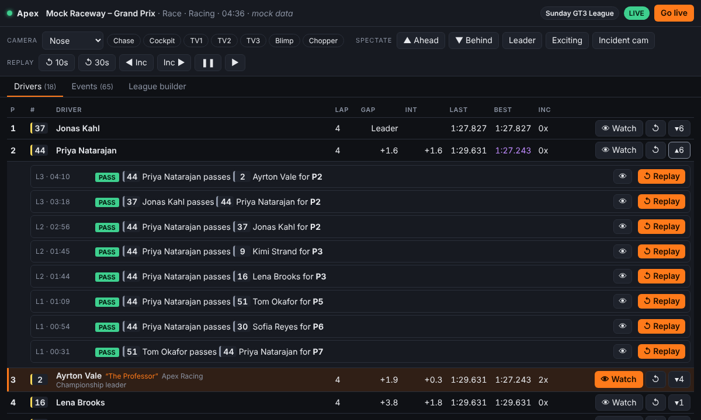
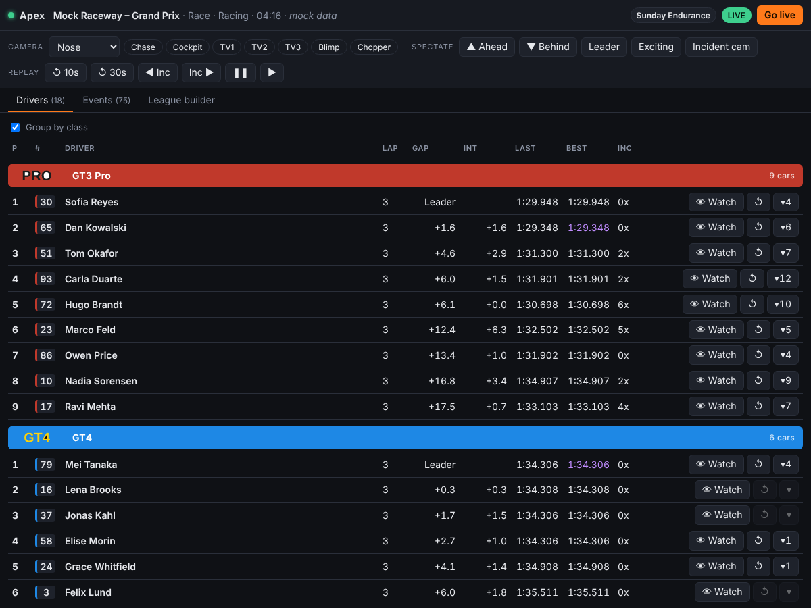

# Apex Commentator

A lightweight iRacing overlay suite for commentators. It runs a small local web
app next to iRacing. Open it in a browser on a second monitor, or add it as an
OBS dock.

- **Live driver list**: positions (live order while racing), gaps, intervals,
  last/best laps, incident points, and pit and off-track status. The car you are
  watching is highlighted.
- **League builder**: pull a league roster from iRacing by **League ID**, then
  add nicknames, teams and notes that show next to each driver in the overlay.
  Define **classes** with your own names, colours and logos. The driver list
  groups by class under coloured headers, and each logo's background is
  recoloured to match its class.
- **Spectate controls**: watch any driver in one click, step to the car
  ahead or behind, jump to the leader, iRacing's incident/exciting cameras, and
  quick camera-group buttons (TV1, Chase, Cockpit…).
- **Replays**: overtakes and incidents are detected for every car and
  saved with their exact session time. One click replays a driver's latest
  moment, or any moment from the event feed, and **Go live** takes you back.
- **Grid walk**: an on-stream graphic that walks the starting grid two drivers
  at a time, with livery, helmet, name, team and team logo. It's shown as cars
  standing on the grid, on a grid map or as a head-to-head, and advances on a
  timer you set.



## Quick start

Requires **Python 3.9+** on the PC running iRacing.

```bat
git clone https://github.com/ShamzOut2/Apex_Commentator
cd Apex_Commentator
start.bat
```

`start.bat` installs the one dependency (`pyirsdk`) and opens
<http://localhost:8180>. Join or spectate a session in iRacing and the
overlay connects automatically. It reconnects if iRacing restarts.

**No iRacing handy?** Run `start-mock.bat` (or `python -m apex --mock`) for a
simulated race. It works on any OS with no dependencies.
`--mock-speed 5` speeds it up.

Other options: `python -m apex --help` (`--port`, `--host`, `--no-browser`,
`--config`).

### Using it from another PC or in OBS

- **Second PC on your LAN:** set `"host": "0.0.0.0"` in `config.json`, then
  open `http://<iRacing-PC-IP>:8180` from the other machine. The overlay
  has no login, so only do this on a network you trust.
- **OBS:** *Docks → Custom Browser Docks*, URL `http://localhost:8180`. The
  layout compacts itself for narrow docks.

## Keyboard shortcuts

| Key | Action |
| --- | --- |
| `L` | Back to live |
| `R` | Instant replay (last 10 s) |
| `↑` / `↓` | Watch the car ahead / behind |

## How replays work

The overlay watches telemetry for **every** car, so this works when you
spectate. It records:

| Event | How it is detected |
| --- | --- |
| **Overtake** | In a race under green, cars close on track swap order *and stay swapped* for 1.5 s, with both on track. Swaps from pit stops, offs or side-by-side jostling don't count. The event is timestamped when the pass started. |
| **Off track** | A car's track surface changes to off track. |
| **Slowdown** | A car's speed collapses relative to its recent pace (spin, contact, stopping). Ignored on pit road and under caution. |
| **Incident points** | When iRacing reports more incident points for a driver, they are attached to that driver's off/slowdown from the last 15 s, or logged as their own incident. |

Pressing **Replay** pauses playback, seeks the replay tape to the event's
session time minus a pre-roll (6 s by default), points the camera at the
driver and plays. It seeks by **session time**, not frame numbers or
iRacing's incident markers, so it lands on the right moment even after you
have been scrubbing around. **Go live** (or `L`) returns to the live feed.
Set `replay_auto_return_s` to return automatically.

Other replay buttons: **↺ 10s / 30s** (instant replay of whoever is on camera),
**◀ Inc / Inc ▶** (step through iRacing's own incident markers), pause/play.

Things to know:

- Replays need iRacing's replay buffer. Keep *Options → Replay → Write
  Replay Data* enabled, and give it enough memory to cover the race.
- Detection pauses while you are watching a replay (telemetry then shows the
  replay, not the live race), so moments that happen during a replay are
  not logged. iRacing's **◀ Inc / Inc ▶** markers still cover them.
- Incident **points** for other drivers only appear if iRacing shares them
  with you, for example as a league admin or in hosted sessions. Off-track and
  slowdown detection works regardless.
- Thresholds (`overtake_hold_s`, `slowdown_ratio`…) can be tuned in
  `config.json`.

## Grid walk


The **Grid walk** tab runs a broadcast graphic that goes through the whole
field, front to back, two drivers at a time:

- **Order**: the grid comes from qualifying. If there are no qualifying
  results yet, the latest qualifying session's results are used, then current
  positions, then car number. Every driver entered in the session is included,
  even if they haven't loaded onto the track (flagged *Not on track*). Drivers
  without a qualifying time go to the back. Use **↑ / ↓** to fix the order by
  hand (inverted grids, penalties), and **Reset order** to go back.
  *League drivers not in session* adds the active league's remaining roster at
  the back.
- **Each driver** shows grid position (and class position in multiclass
  races), car number in the class colour, class logo, name, nickname, team,
  team logo, car livery and helmet. *Grid on track* also paints each slot's
  qualifying time on the tarmac: the lap time for the class pole, and the gap
  to it for everyone else.
- **Photos**: upload a car livery photo and a helmet photo per driver in the
  league builder (**Photos** column), and team logos in the **Teams**
  section. For *Grid on track*, the ideal car image is a **transparent PNG
  render** of the car in 3/4 view, nose pointing right, so it stands in the
  grid box like a TV grid walk. A driver without photos gets a car and helmet
  drawn in their actual iRacing paint colours (from the sim's design
  strings), so nobody shows up blank.
- **Controls**: *Start from P1*, *Pause/Resume*, *Prev/Next* pair, *Show*
  on any driver to jump to their pair, and *Hide* to take it off screen.
  *Seconds per pair* sets the timer, and *Loop* restarts from the front.
  Without Loop, the graphic leaves the screen after the last pair.
- **Style**:
  - *Grid on track* (default): the pair stands in painted, staggered grid
    boxes on an angled stretch of track, with slot numbers and qualifying
    gaps on the tarmac. Name, number and team go in opposite corners with
    the team logos. It's a full-frame scene with its own background.
  - *Grid map* draws the whole grid with the current pair lit up, and the
    two driver cards in their boxes.
  - *Head to head* puts the pair side by side.

| Grid map | Head to head |
| --- | --- |
|  |  |

**On stream**: in OBS add a **Browser Source** of 1920×1080 pointing at
`http://localhost:8180/gridwalk.html`. The *Grid map* and *Head to head*
styles have a transparent background, so they sit over your game feed. The walk runs on the server, so the OBS source, the
preview in the tab, and any other copy all stay in step. Add `?preview=1` to
the URL to view it on a backdrop in a normal browser.

## League builder

Open the **League builder** tab.

1. **Fetch by League ID**: pulls the league name and roster (names, customer
   IDs, car numbers, nicknames) from the iRacing Data API. Needs API
   credentials (below).
2. **Build from the current session**: no credentials needed. It takes the
   drivers in the session you are in.
3. **Blank league**: type it in by hand.

Edit nicknames, teams and notes (for example "Championship leader" or a
pronunciation hint), **Save**, then **Use in overlay**. Drivers are matched by
iRacing customer ID, or by car number for hand-added entries without one.
Re-fetching a league updates names and numbers, adds new members and keeps your
notes. Profiles are plain JSON in `data/leagues/`.

### Classes and logos


Each class has a **name**, a **colour**, and optionally a **logo**.
**Build from the current session** creates one class per iRacing car class,
in iRacing's colours. Rename and recolour them as you like, or add your own
(for example Pro and Am within the same car).

A driver's class comes from:

1. the **Class** picked for them in the roster, or otherwise
2. the first class whose **iRacing classes** list contains their car class
   (e.g. `GT3`), or otherwise
3. their iRacing car class as-is.

In the **Drivers** tab, *Group by class* shows each class under its header,
with positions, gaps and intervals within the class.



**Built-in logos.** The league's tier logos ship with the app as layered
SVGs in `web/logos/`: PRO, SEMI-PRO, PRO-AM, AM, GOLD, SILVER and BRONZE.
Pick one from a class's **Logo** list. A class named after one of them
("Pro", "Semi Pro", "Gold"…) picks it up automatically. The badge is drawn
in exactly the class colour. The lettering stays white unless white would be
hard to read on that colour (under 3:1 contrast), when it turns dark: Gold
and Silver, for example.

**Logo backgrounds.** You can also upload your own PNG, JPG, WebP or SVG (up
to 8 MB) per class. For SVGs with marked layers, the overlay recolours those
layers exactly (see *Adding logos* below). For any other image it replaces
the logo's background with the class colour, so the logo blends into the
header, and the result updates live as you change the colour:

- **Auto-detect** reads the background from the logo's border: transparent,
  or its most common colour (white, black…). The detected colour is shown
  under the class.
- **Pick logo background** names the colour to replace, for logos where
  auto-detect guesses wrong.
- **Keep logo as is** turns recolouring off.
- **Tolerance** sets how close to the background a pixel must be to get
  recoloured. Raise it for JPEG noise; lower it if parts of the logo get
  eaten.
- **Enclosed areas too** also recolours background-coloured areas that don't
  touch the edge, like the inside of an "O". It's off by default because it
  would also recolour white artwork inside the logo.

By default only the background connected to the logo's edge is replaced,
with anti-aliased edges blended into the new colour. Your original file is kept
untouched, in `data/leagues/logos/<league>/`.

**Adding logos.** `tools/logo_to_svg.py` turns a dark-badge, light-lettering
logo (like the built-in ones) into a layered SVG. Straight badge edges are
fitted as exact lines, and the lettering is traced with Potrace.

```
pip install pillow potracer          # only needed for the converter
python tools/logo_to_svg.py my-logo.png --out-dir web/logos
```

Drop the result in `web/logos/` to add it to the library, or upload it to a
class. In a hand-made SVG, mark the part that should take the class colour
with `data-apex-fill="class"`, and the lettering with `data-apex-fill="ink"`.

### iRacing API credentials

iRacing retired username/password API logins in December 2025. The Data
API now uses OAuth, and a script like this needs a **client ID and client
secret** issued by iRacing ("password limited" grant) plus your iRacing login.
iRacing support handles client ID requests, and has paused new ones at times.
See their [OAuth client credentials article](https://support.iracing.com/support/solutions/articles/31000177790-oauth-client-credentials).

Put them in `config.json` (copy `config.example.json`; `config.json` is
git-ignored) or set environment variables:

```bat
set IRACING_USERNAME=you@example.com
set IRACING_PASSWORD=...
set IRACING_CLIENT_ID=...
set IRACING_CLIENT_SECRET=...
```

Credentials are masked as iRacing requires before they are sent, and only go
to `oauth.iracing.com` and `members-ng.iracing.com`.

## Updates

On start-up, and every few hours after, the app checks this repository's
GitHub releases. When a newer version is out, the control panel pops up
with its release notes:

- **Update now** downloads the release and installs it over your copy, then
  the app restarts itself. Open pages, including OBS sources, reload on the
  new version. Your `config.json` and everything in `data/` (leagues, logos,
  photos) are kept.
- **Later** hides the pop-up until the app is next opened. The *Update to
  vX* button in the top bar reopens it.
- **Skip this version** stops the pop-up for that version, but the next one
  will still pop up.

If your copy is a **git clone**, the app won't overwrite it. It tells you
to run `git pull` instead. To turn update checks off, set
`"update_check": false`.

### Publishing a new version

1. Bump `__version__` in `apex/__init__.py` (e.g. `0.2.0`).
2. Add a `## v0.2.0` section to `CHANGELOG.md`: it becomes the release notes
   shown in the pop-up.
3. Commit, then tag and push the tag:

   ```
   git tag v0.2.0
   git push origin v0.2.0
   ```

The **Release** GitHub Actions workflow checks that the tag matches the app
version, runs the tests, and publishes the GitHub release. Every running
copy of the app then offers the update.

## Configuration

All keys are optional. See `config.example.json` for the full list and
defaults:

| Key | Default | Meaning |
| --- | --- | --- |
| `port` / `host` | `8180` / `127.0.0.1` | Where the overlay is served |
| `replay_preroll_s` | `6` | Seconds before the event a replay starts |
| `replay_auto_return_s` | `0` | Return to live after N seconds (0 = manual) |
| `default_camera_group` | `""` | Camera group for Watch/Replay, e.g. `"TV1"` (blank = keep current) |
| `overtake_hold_s` | `1.5` | How long a pass must hold to count |
| `slowdown_ratio` | `0.35` | Speed below this fraction of recent pace counts as a slowdown |
| `event_cooldown_s` | `8` | Minimum gap between incidents logged for the same car |
| `gridwalk_interval_s` | `8` | Grid walk: seconds each pair stays on screen |
| `gridwalk_style` | `"track"` | Grid walk style: `"track"`, `"grid"` or `"h2h"` |
| `update_check` | `true` | Check GitHub for new versions and offer them in the app |
| `update_repo` | `"ShamzOut2/Apex_Commentator"` | Where releases are published |
| `github_token` | `""` | Only needed if that repository is private (or set `APEX_GITHUB_TOKEN`) |

## Development

```
apex/
  sources.py   iRacing (pyirsdk) and mock telemetry sources
  events.py    overtake / incident detection
  core.py      poll loop, snapshot, spectate & replay commands
  gridwalk.py  grid order and grid walk state
  league.py    iRacing Data API client and league profiles
  server.py    stdlib HTTP server + Server-Sent Events
  updater.py   update checks and in-app updates from GitHub releases
web/           the overlay UI (plain HTML/CSS/JS, no build step)
  index.html   control panel (app.js)
  gridwalk.html  grid walk broadcast graphic for OBS (gridwalk.js)
  common.js    shared helpers: logo recolouring, drawn liveries
  logos/       built-in layered class logos
tools/
  logo_to_svg.py  converts badge logos to layered SVG (dev only)
tests/
```

Run the tests with `python -m unittest discover -s tests -t .`. They need
nothing installed. The iRacing source is tested against a stand-in for
pyirsdk.
